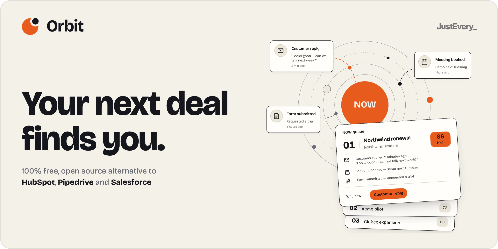
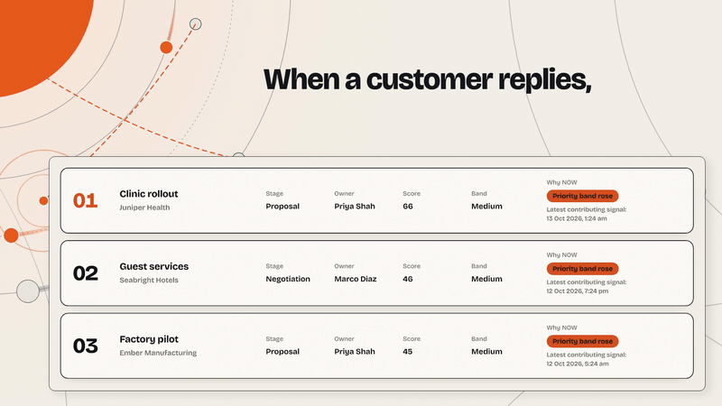
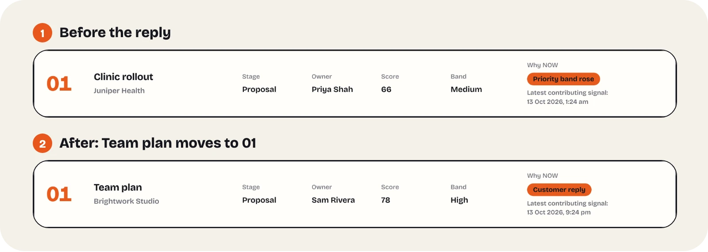
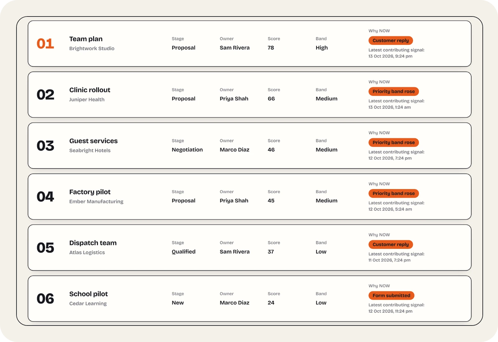
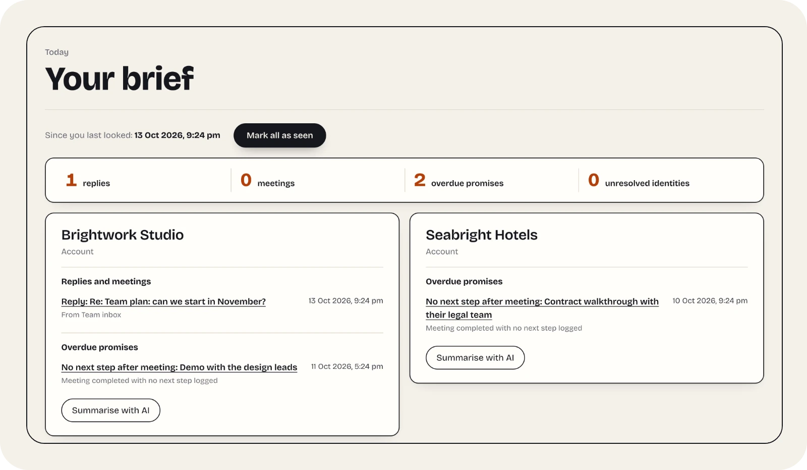
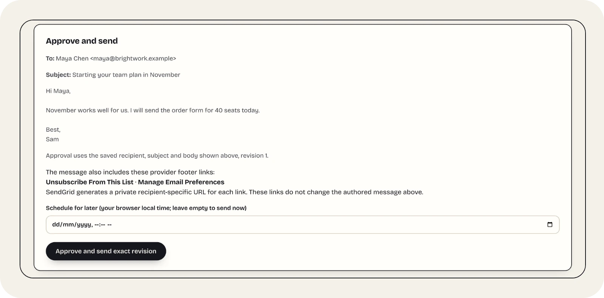

<p align="center">
  <a href="https://run-orbit.com">
    <picture>
      <source media="(prefers-color-scheme: dark)" srcset=".github/assets/banner-dark.webp">
      <source media="(prefers-color-scheme: light)" srcset=".github/assets/banner-light.webp">
      
    </picture>
  </a>
</p>

<p align="center"><a href="https://run-orbit.com">run-orbit.com</a> · <a href="https://justevery.com">Part of Just Every</a> · <a href="LICENSE">MIT licensed</a></p>

<p align="center">
  <a href="https://justevery.com/#vol-orbit"></a>
</p>
<p align="center"><a href="https://justevery.com/#vol-orbit"><b>Watch the full demo</b></a> · 51 seconds</p>

<p align="center">
  
</p>

<p align="center">
  <br>
  <sub>Every deal in NOW says why it is there.</sub>
</p>

<p align="center">
  <br>
  <sub>A daily brief of what changed since you last looked.</sub>
</p>

<p align="center">
  <br>
  <sub>Nothing goes to a customer until you approve the exact message.</sub>
</p>

# Orbit

Orbit is the Sales edition for account selling guided by customer evidence. Its interface keeps stage, owner, score, queue and message state separate, and operators review every customer message before it is sent.

This repository is the complete source for Orbit. Public source: [just-every/run-orbit](https://github.com/just-every/run-orbit), licensed under the [MIT License](LICENSE). These instructions describe the current `main` branch. The older `v0.1.0` tag has different setup commands and predates Capture and the current local sign-in flow. Current local sign-in uses the private `RER_OPEN` link described below. Use the README included with the tag if you check it out. Read [ACCEPTANCE.md](ACCEPTANCE.md) for the product's acceptance obligations, [CONTRACT.md](CONTRACT.md) for its clauses and [OPERATIONS.md](OPERATIONS.md) for hosted configuration, mail, data transfer and recovery.

## Run it on your computer

You install nothing first. The same one line as [run-orbit.com/run](https://run-orbit.com/run) gets Orbit and starts it:

```sh
npx -y @runeditrun/rer dev just-every/run-orbit
```

No Node? `curl -fsSL https://runeditrun.com/install.sh | sh -s -- dev just-every/run-orbit` brings its own and does the same.

To start it again later: `cd run-orbit && rer dev`.

Orbit pins Node **22.20.0** and pnpm **10.12.4** for project commands; `rer` brings both into its own cache and installs the frozen dependencies, so you install neither yourself. `rer dev just-every/run-orbit` clones the current `main`. `dev` installs dependencies, prepares local settings and starts Orbit. On the first launch it prepares the local trial owner (`owner@run-orbit.test`); it keeps that owner, your data and settings on later launches. You can change the owner email in Settings → Installation owner. A later deploy uses that current owner unless you explicitly supply `OWNER_EMAIL`. To use your real mailbox from the start, run `npx -y @runeditrun/rer install just-every/run-orbit`, then `rer setup --owner-email EMAIL` from the checkout, before `rer dev`.

Once `/health` answers, `dev` prints `RER_READY`, `RER_SIGNED_IN` and `RER_OPEN`. Open the `RER_OPEN` link on this computer: Orbit opens signed in as you. Its fragment carries this checkout's private dev key, so never share it. The product name reads Orbit Dev. Use `rer dev --as seller` or `--as collaborator` to choose a persona. Local sign-in needs no email: `RER_OPEN` signs you in. Customer mail you approve is real: once you add your own SendGrid settings in Settings → Customer mail sender, it goes to the customer's inbox even from your computer. Stop it with `rer dev --stop`, including when the launch command has returned to your prompt.

No owner JSON file is needed: the owner email flag and first-run form supply the installation details.

Your first sign-in opens **first-run setup at `/setup`**: confirm the business name, time zone, currency and pipeline stages, then finish. Until you do, every app page returns you to `/setup`; afterwards `/setup` takes you into the app, and Settings holds later changes.


### Get your first signal

Open NOW and follow the checklist. Add a company and contact with **Add your first customer**, then open Sources and connect a source. Orbit generates its signing secret and shows it once; copy it into the connected tool's private settings. Each recipe includes the installation's endpoint and an executable example. The website recipe embeds Orbit's reviewed, published contact form. **Send test event** selects your latest contact by default and records a clearly marked test through the signed ingestion path.

Open the opportunity from NOW, choose **Write follow-up**, save the exact message and review **Approve and send**. Sending needs a configured customer mail sender; source setup and manual drafts work without one. **See an example** opens a separate read-only workspace and never adds sample customers to yours.

### Capture mail and calendars

Open **Capture** to import mail/calendar files or connect Gmail and Google Calendar, or Outlook mail and calendars. Each connection uses your own OAuth client and read-only permissions. Choose labels or folders and calendars before intake starts; calendar capture also has a fixed date window. Capture shows evidence and proposals for review, with the existing reply, bounce and stop-condition safeguards.

Follow [Google setup](docs/CONNECT-GMAIL.md) or [Microsoft setup](docs/CONNECT-OUTLOOK.md). [OWNER-STEPS.md](OWNER-STEPS.md) contains the remaining live-account proof. Copy each provider's exact callback URI from Capture; a successful `rer deploy` also prints them. `rer dev` does not print callback URIs. Disconnect stops intake and deletes the saved provider credentials.

### Verify, reset and move data

Stop `dev` and `preview` before CLI export, import, reset, build or verification (`rer dev --stop` and `rer preview --stop`).

```sh
rer verify
rer reset --yes
rer export --output exports/orbit.rer
rer import --input exports/orbit.rer --yes
```

- `verify` runs the retained public-flow sanity journeys with isolated temporary state; full declared-capacity clauses remain pending. It replaces generated `verification/` outputs; tracked historical evidence is retained under `docs/retained-verification/`. Before release, run `pnpm run verify:release` for the routine checks plus the unchanged full-capacity qualification (see [TESTING.md](TESTING.md)). Stop `dev` and `preview` first; verification never touches your state.
- `reset` lists exactly what it removes (`.wrangler/state`, `.rer/local`, `.seed/installer`, `.dev.vars`) and needs `--yes`. It refuses while `dev` or another local operation owns the state, and keeps source, dependencies, `exports/` and deployment receipts in `.rer/deploy/`. Run `setup` again afterwards for a fresh, empty installation.
- `export` writes a new owner-only archive of every Orbit table with a content hash, row counts and the exclusions it lists. `import` restores an archive into an empty local installation (after `reset --yes`), then rebuilds search; run `setup` with the archive's owner email to sign in again. Archives contain private customer data.

### Deploy to your Cloudflare account

Orbit runs on your own Cloudflare account; the free Workers plan is enough to start. You need five values. Collect them once, keep them in one private file, and pass that file to `rer deploy`.

1. **Cloudflare account ID.** Sign in at [dash.cloudflare.com](https://dash.cloudflare.com) (create a free account if you have none). The address bar then reads `dash.cloudflare.com/` followed by a 32-character code: that code is your account ID. It is also shown as **Account ID** on [Workers & Pages](https://dash.cloudflare.com/?to=/:account/workers-and-pages).
2. **workers.dev subdomain.** Open [Workers & Pages](https://dash.cloudflare.com/?to=/:account/workers-and-pages) once. If Cloudflare asks you to choose your `workers.dev` subdomain, pick a name and confirm. Orbit's address becomes `https://sales-orbit-production.<that name>.workers.dev`. If a subdomain is already shown, there is nothing to do.
3. **Cloudflare API token.** Open [My Profile → API Tokens](https://dash.cloudflare.com/profile/api-tokens) → **Create Token** → **Create Custom Token** → **Get started**. Name it `Orbit deploy`. Under **Permissions**, add exactly two rows: **Account · Workers Scripts · Edit** and **Account · D1 · Edit**. Under **Account Resources**, choose **Include · your account**. Choose **Continue to summary** → **Create Token**, then copy the token: Cloudflare shows it only once.
4. **Your owner email.** The mailbox you sign in with. Hosted Orbit emails you a sign-in link there.
5. **Sign-in mail.** Hosted Orbit sends sign-in links through SendGrid, so it needs a verified sender email (`MAIL_FROM`) and a SendGrid API key (`SENDGRID_API_KEY`). Run `rer dev`, open **Settings → Customer mail sender** and follow steps 1 and 2 there: they show exactly where to verify a sender and create a key with Mail Send access.

Create a private file named `.dev.vars.deploy` in your Orbit folder with a plain text editor (on a Mac, `touch .dev.vars.deploy && open -e .dev.vars.deploy`). Put the values in it, one per line, without spaces around `=`:

```sh
CLOUDFLARE_ACCOUNT_ID=your-32-character-account-id
CLOUDFLARE_API_TOKEN=your-api-token
OWNER_EMAIL=you@example.com
MAIL_FROM=you@example.com
SENDGRID_API_KEY=SG.your-key
```

Save it, then make it readable only by you and deploy. Git already ignores files named `.dev.vars*`, so it is never committed. Stop `rer dev` first if it is running in this folder (`rer dev --stop`): deploy refuses while dev holds the local state.

```sh
rer dev --stop
chmod 600 .dev.vars.deploy
rer deploy --dry-run --env-file .dev.vars.deploy
rer deploy --env-file .dev.vars.deploy
```

The dry run builds and checks everything without contacting Cloudflare, lists anything still missing, and lists optional values separately: those turn on extra features (reply capture, delivery outcomes, AI drafts) and can be added later from the app's own setup pages. The real deploy prints your Orbit's address when it finishes. You can also export the same five names as environment variables in your terminal instead of using a file. Later commands the app shows you, such as connecting customer mail or delivery outcomes, take the same `--env-file .dev.vars.deploy`.

[OPERATIONS.md](OPERATIONS.md) lists every optional secret and what to keep. `rer release --help` describes source releases; `release` never pushes or deploys.

For hosted sign-in, open your deployed origin's `/signin`, enter your active operator email, open the emailed link and press **Confirm**. Once signed in, change the owner email in Settings → Installation owner. Local `RER_OPEN` dev credentials cannot sign in to a hosted installation. If mail does not arrive, check the address is active in Settings → Installation owner, the sender is verified and both hosted mail secrets are configured. Restore keeps current hosted full operators, including the active owner, and imports new archived operators as ordinary operators. The archive's own owner, the local trial owner and local dev personas (`@dev.localhost`) are restored without access when this installation already has a different owner, so their past actions keep their names. Source signing secrets are excluded; open Sources and choose Reconnect source to create a new secret for each tool. Restore revokes sessions; sign in again with the hosted owner's mailbox.

To remove a deployment you created with this checkout, pass the same private file so `rer` can reach your Cloudflare account:

```sh
rer deploy --remove --yes --env-file .dev.vars.deploy
```

Add the same `--environment NAME` as deployment if you chose one. Keep `.rer/deploy/<environment>.json`: RER uses it to identify the resources it created and confirms their removal. Export a private backup first; removing the deployment deletes its hosted data.

Managed Configure reads `rer-setup.json` and `management/integration/deployment-spec.json` directly from this repository. After changing deployment inputs or migrations, run `rer build` then `pnpm run deployment:spec`. Verify fails on drift against the emitted build. Managed owner claims use RER’s signed confirmation with a hidden generated setup token; direct deploy claims through `POST /auth/bootstrap`.

`rer describe` lists every command, flag, effect and pin; `rer doctor` diagnoses tools and local settings.

## Author and release

`edition.json` selects the edition-owned source graph; `sources.lock.json` records effective bytes and retained comparison origins. Follow [AUTHORING.md](AUTHORING.md) to inspect, lock, check, materialize and release from this repository. `composition.lock.json` is historical import evidence only; it never replaces local source or selects a current release. Preserve migrations and recorded owner intent when integrating updates.

The command line and setup lifecycle come from the exact `@runeditrun/rer` version in devDependencies and pnpm-lock.yaml. `rer check --profile first-party` checks the package-mode contract. Shared application runtime copies retain their Base provenance in `base-copies.json` and `sources.lock.json`; Orbit's adapter remains `scripts/installer/local.mjs`.

## Customise and share improvements

The maintained edition defaults save integration and verification work. Configuration and hooks are conveniences; editing domain internals, core schema, UI, framework or infrastructure is ordinary authoring too. Choose the change that serves the owner's outcome, without a required sequence of extension mechanisms. Complex merges and adaptation are the agent's work. Preserve the owner's actual requirements wherever recorded: `CONTRACT.md`, `DIVERGENCE.md`, owner instructions and optional `.seed/intent.md`; no particular intent file or registry is required.

Feed useful mechanisms, defaults and verification cases back into shared source when they would save work in another edition. Their natural home may be this edition, a family, Base or an independent repository; no separate repository per module or universal compatibility interface is required. Verify adoption against the receiving product's requirements, including deliberate local differences.

The edition carries editable shared SendGrid transport and authoring 1.1 source. `node scripts/edition-authoring/cli.mjs changes` explains changed inputs; `extract` and `compare` provide retained source and incoming comparison context. SendGrid 202 is accepted with a nullable provider receipt: local correlation identifies the command, not remote delivery, and uncertain submissions are reconciled without automatic repetition.
